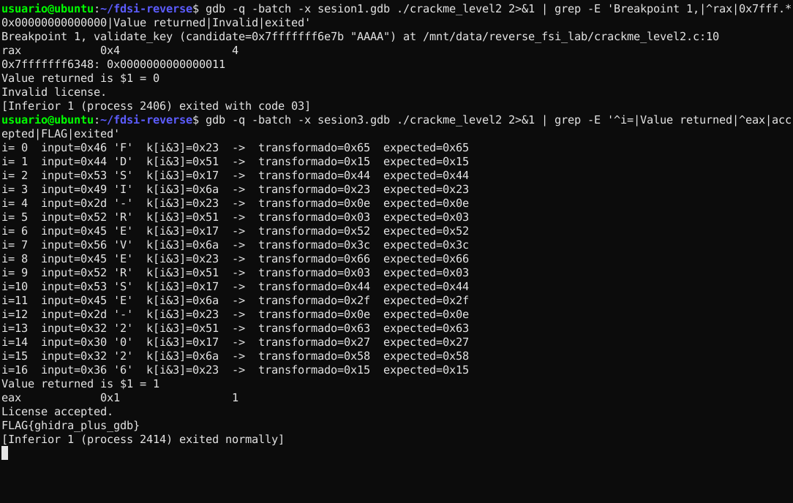
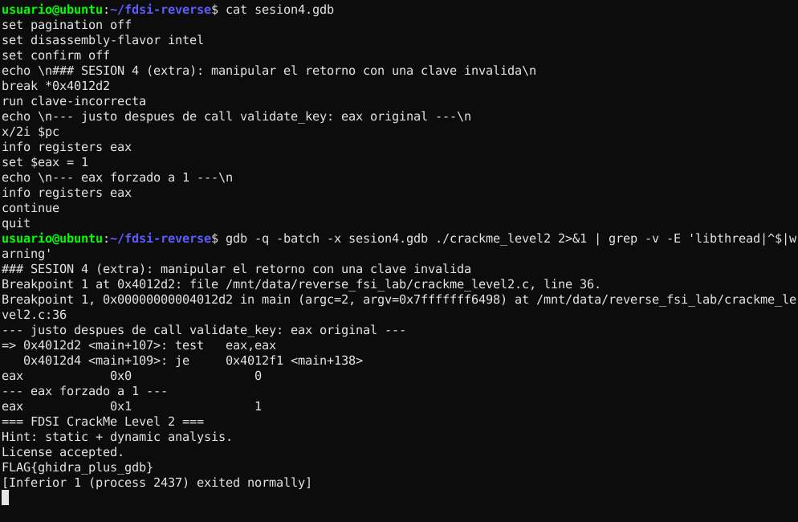
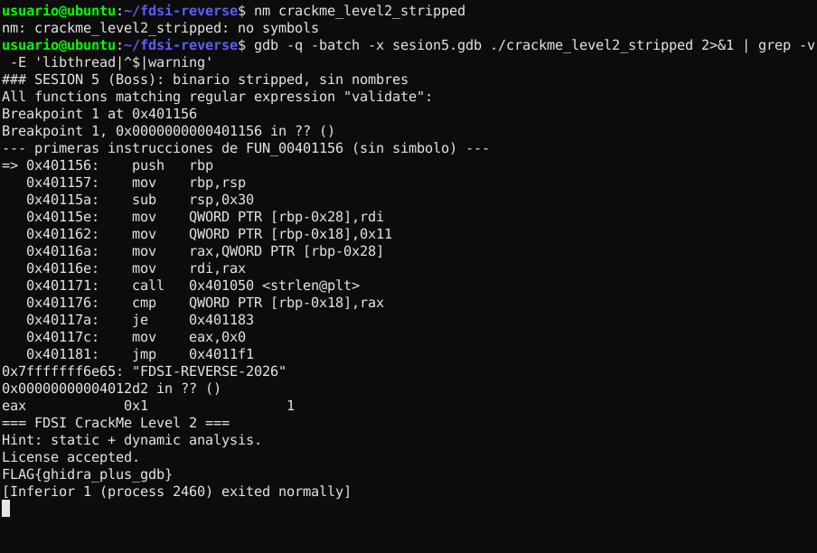

# Confirmación dinámica con GDB

> "No se trata de adivinar; se trata de demostrar en ejecución que la hipótesis está bien."

**Hipótesis que se confirma (de [`level2.md`](level2.md)):**
`validate_key(s)` retorna 1 ⇔ `strlen(s) == 17` y, para todo `i`, `s[i] ^ K[i%4] == E[i]`, con `K = 23 51 17 6a`.

**Entorno:** GNU gdb 15 · Ubuntu 24.04 x86-64 · `set disassembly-flavor intel`
**Reproducibilidad:** cada sesión se ejecutó en modo batch con un archivo de comandos ([`scripts/gdb/sesionN.gdb`](../../../scripts/gdb/)): `gdb -q -batch -x sesionN.gdb ./crackme_level2`. La salida completa y sin editar está en `raw/gdb_session*.txt`. Los comandos también se pueden escribir uno por uno en una sesión interactiva.

> **Nota:** las direcciones de **pila** (`0x7fffffff…`) y los PID cambian entre ejecuciones porque dependen del entorno (variables de entorno, ASLR desactivado por GDB). Por eso los valores de los fragmentos citados pueden diferir de los de `raw/`. Las direcciones del **binario** (`0x401156`, `0x40208b`, `0x402090`…) son fijas porque el ejecutable no es PIE, y todos los valores de registros y datos (`rax=4`, `0x11`, `0x7f`, `eax=1`) son idénticos en cada ejecución.

Mapa de registros y variables (relación con el pseudocódigo de Ghidra):

| Ubicación | Variable en Ghidra | Significado |
|---|---|---|
| `rdi` al entrar | `candidate` / `user_key` | Puntero a `argv[1]` (1.er argumento, System V ABI) |
| `[rbp-0x28]` | `candidate` (copia) | Puntero a la clave |
| `[rbp-0x18]` | `n` | Longitud esperada = `0x11` |
| `[rbp-0x10]` | `i` | Índice del bucle |
| `ecx` en `0x4011b9` | `candidate[i]` | Byte de entrada |
| `eax` en `0x4011b9` | `k[i & 3]` | Byte de la clave XOR |
| `[rbp-0x19]` | `transformed` | `candidate[i] ^ k[i&3]` |
| `[rbp-0x4]` | `score` | Acumulador OR |
| `eax` al retornar | valor de retorno | 1 = válida, 0 = inválida |

---

## Sesión 1: clave fallida corta (`AAAA`), rechazo por longitud

Comandos (los mismos de la guía, más dos breakpoints de apoyo):

```gdb
set disassembly-flavor intel
break validate_key
run AAAA
disassemble validate_key
info registers rip rdi rsp rbp
x/s $rdi
x/4xb 0x40208b          # K
x/17xb 0x402090         # EXPECTED
break *0x40117a         # justo después del cmp de longitud
continue
info registers rax
x/gx $rbp-0x18
finish
info registers eax
continue
```

Salida relevante ([`raw/gdb_session1.txt`](raw/gdb_session1.txt)):

```text
Breakpoint 1, validate_key (candidate=0x7fffffff6ed7 "AAAA") at /mnt/data/reverse_fsi_lab/crackme_level2.c:10

=> 0x0000000000401162 <+12>:	mov    QWORD PTR [rbp-0x18],0x11
   0x0000000000401171 <+27>:	call   0x401050 <strlen@plt>
   0x0000000000401176 <+32>:	cmp    QWORD PTR [rbp-0x18],rax
   0x000000000040117a <+36>:	je     0x401183 <validate_key+45>
   0x000000000040117c <+38>:	mov    eax,0x0
   ...
--- argumento recibido (rdi) ---
0x7fffffff6ed7:	"AAAA"
--- datos en .rodata usados por la funcion ---
0x40208b <k.1>:	0x23	0x51	0x17	0x6a
0x402090 <expected.0>:	0x65	0x15	0x44	0x23	0x0e	0x03	0x52	0x3c
0x402098 <expected.0+8>:	0x66	0x03	0x44	0x2f	0x0e	0x63	0x27	0x58
0x4020a0 <expected.0+16>:	0x15
--- en el cmp de longitud: rax = strlen(input) vs [rbp-0x18] ---
rax            0x4                 4
0x7fffffff63d8:	0x0000000000000011
Value returned is $1 = 0
eax            0x0                 0
Invalid license.
[Inferior 1 (process 2131) exited with code 03]
```

**Qué demuestra:** `strlen` devolvió `4` (`rax`) y se comparó con `0x11` (17) guardado en `[rbp-0x18]`. El `je` no salta, se ejecuta `mov eax,0x0` y la función retorna **0** sin entrar al bucle. Esto confirma la primera condición (longitud 17) y los valores de `K` y `EXPECTED` en memoria, que coinciden con los de Ghidra.

## Sesión 2: longitud correcta, contenido incorrecto (`A` × 17)

```gdb
break *0x4011d5          # instrucción  or DWORD PTR [rbp-0x4],eax
run AAAAAAAAAAAAAAAAA
info registers eax
x/gx $rbp-0x10           # i
delete
break *0x4011e7          # cmp DWORD PTR [rbp-0x4],0x0  (fin del bucle)
continue
x/wx $rbp-0x4            # score
finish
```

Salida ([`raw/gdb_session2.txt`](raw/gdb_session2.txt)):

```text
--- iteracion i=0: al=expected[0]^(input[0]^k[0]) -> se acumula con OR ---
eax            0x7                 7
0x7fffffff63d0:	0x0000000000000000
--- fin del bucle: acumulador score [rbp-0x4] ---
0x7fffffff63dc:	0x0000007f
Value returned is $1 = 0
eax            0x0                 0
Invalid license.
```

**Qué demuestra:** ahora sí se entra al bucle. En `i=0`: `'A'(0x41) ^ 0x23 = 0x62` y `0x62 ^ 0x65 = 0x07`, que es exactamente el `eax = 7` observado. Al final, `score = 0x7f ≠ 0`, así que `sete al` deja `eax = 0`. Esto confirma la transformación XOR y el acumulador OR.

## Sesión 3: clave candidata `FDSI-REVERSE-2026` aceptada

Breakpoint en `0x4011b9` (`xor eax,ecx`) con comandos automáticos para imprimir los operandos en cada iteración:

```gdb
break *0x4011b9
commands
  silent
  printf "i=%2d  input=0x%02x '%c'  k[i&3]=0x%02x  ->  transformado=0x%02x  expected=0x%02x\n", \
         *(long*)($rbp-0x10), $ecx, $ecx, $eax, ($eax^$ecx)&0xff, *(unsigned char*)(0x402090+*(long*)($rbp-0x10))
  continue
end
break *0x4011e7
run FDSI-REVERSE-2026
x/wx $rbp-0x4
finish
info registers eax
```

Salida ([`raw/gdb_session3.txt`](raw/gdb_session3.txt)):

```text
i= 0  input=0x46 'F'  k[i&3]=0x23  ->  transformado=0x65  expected=0x65
i= 1  input=0x44 'D'  k[i&3]=0x51  ->  transformado=0x15  expected=0x15
i= 2  input=0x53 'S'  k[i&3]=0x17  ->  transformado=0x44  expected=0x44
i= 3  input=0x49 'I'  k[i&3]=0x6a  ->  transformado=0x23  expected=0x23
i= 4  input=0x2d '-'  k[i&3]=0x23  ->  transformado=0x0e  expected=0x0e
i= 5  input=0x52 'R'  k[i&3]=0x51  ->  transformado=0x03  expected=0x03
i= 6  input=0x45 'E'  k[i&3]=0x17  ->  transformado=0x52  expected=0x52
i= 7  input=0x56 'V'  k[i&3]=0x6a  ->  transformado=0x3c  expected=0x3c
i= 8  input=0x45 'E'  k[i&3]=0x23  ->  transformado=0x66  expected=0x66
i= 9  input=0x52 'R'  k[i&3]=0x51  ->  transformado=0x03  expected=0x03
i=10  input=0x53 'S'  k[i&3]=0x17  ->  transformado=0x44  expected=0x44
i=11  input=0x45 'E'  k[i&3]=0x6a  ->  transformado=0x2f  expected=0x2f
i=12  input=0x2d '-'  k[i&3]=0x23  ->  transformado=0x0e  expected=0x0e
i=13  input=0x32 '2'  k[i&3]=0x51  ->  transformado=0x63  expected=0x63
i=14  input=0x30 '0'  k[i&3]=0x17  ->  transformado=0x27  expected=0x27
i=15  input=0x32 '2'  k[i&3]=0x6a  ->  transformado=0x58  expected=0x58
i=16  input=0x36 '6'  k[i&3]=0x23  ->  transformado=0x15  expected=0x15

--- fin del bucle: acumulador score [rbp-0x4] ---
0x7fffffff63dc:	0x00000000
Value returned is $1 = 1
eax            0x1                 1
License accepted.
FLAG{ghidra_plus_gdb}
[Inferior 1 (process 2145) exited normally]
```

**Qué demuestra:**

- La columna `k[i&3]` repite `23 51 17 6a`. **El arreglo se reutiliza de forma cíclica**, como se dedujo del `and eax,0x3`.
- En las 17 iteraciones, `transformado == expected`, así que cada término del OR es 0 y `score = 0`.
- `validate_key` **retorna 1** y `main` sigue el camino de éxito.

### Comparación fallida vs. válida

| Entrada | `strlen` | ¿Entra al bucle? | `score` final | Retorno `eax` | Salida |
|---|---|---|---|---|---|
| `AAAA` | 4 | No | - | **0** | `Invalid license.` (exit 3) |
| `AAAAAAAAAAAAAAAAA` | 17 | Sí | `0x7f` | **0** | `Invalid license.` (exit 3) |
| `FDSI-REVERSE-2026` | 17 | Sí | `0x00` | **1** | `License accepted.` + FLAG (exit 0) |

## Sesión 4 (extra): lo que GDB confirma y el análisis estático no

Con una clave **inválida**, nos detenemos justo después de `call validate_key` (en `0x4012d2`, `test eax,eax`) y modificamos el registro:

```gdb
break *0x4012d2
run clave-incorrecta
x/2i $pc
info registers eax
set $eax = 1
continue
```

```text
=> 0x4012d2 <main+107>:	test   eax,eax
   0x4012d4 <main+109>:	je     0x4012f1 <main+138>
eax            0x0                 0
--- eax forzado a 1 ---
eax            0x1                 1
License accepted.
FLAG{ghidra_plus_gdb}
```

**Qué demuestra:** toda la "seguridad" depende de **un solo bit en un registro** que controla quien ejecuta el programa. El análisis estático permitía suponerlo, pero GDB lo **demuestra**: el control se puede saltar sin conocer la clave. Por eso las decisiones de autorización no pueden vivir en código que corre del lado del usuario ([`raw/gdb_session4.txt`](raw/gdb_session4.txt)).

## Sesión 5: Boss, mismo análisis sin símbolos

En `crackme_level2_stripped`, `break validate_key` ya no funciona (`info functions validate` no devuelve nada), así que se pone el breakpoint **por dirección**. La dirección se encontró con el flujo descrito en [`../../../reverse-analysis.md`](../../../reverse-analysis.md#5-boss-level-binario-sin-símbolos):

```gdb
info functions validate      # -> vacío
break *0x401156
run FDSI-REVERSE-2026
x/12i $pc
x/s $rdi
finish
info registers eax
```

```text
All functions matching regular expression "validate":
Breakpoint 1, 0x0000000000401156 in ?? ()
=> 0x401156:	push   rbp
   ...
   0x401162:	mov    QWORD PTR [rbp-0x18],0x11      ← misma firma: longitud 17
   0x401171:	call   0x401050 <strlen@plt>
   0x401176:	cmp    QWORD PTR [rbp-0x18],rax
0x7fffffff6ec1:	"FDSI-REVERSE-2026"
0x00000000004012d2 in ?? ()
eax            0x1                 1
License accepted.
FLAG{ghidra_plus_gdb}
```

Control negativo en el stripped con 17 `A` ([`raw/gdb_session5b.txt`](raw/gdb_session5b.txt)): `eax = 0`, `Invalid license.`

Sin símbolos GDB muestra `?? ()` en lugar del nombre de la función, pero el comportamiento es idéntico. El código máquina no cambió (ver `raw/strip_diff.txt`: `.text` y `.rodata` tienen el mismo hash).

## Observación: la información de depuración también ayuda al atacante

En el binario no stripped, GDB muestra `candidate=... "AAAA"`, el número de línea y la ruta `/mnt/data/reverse_fsi_lab/crackme_level2.c`. Todo eso sale de las secciones `.debug_*` (DWARF): nombres de parámetros, de variables locales y la estructura del fuente original. Distribuir binarios compilados con `-g` facilita mucho el reverse engineering.

## Capturas

**Sesiones 1 y 3: clave fallida vs. válida**



**Sesión 4: bypass forzando `eax = 1`**



**Sesión 5: binario stripped, breakpoint por dirección**


