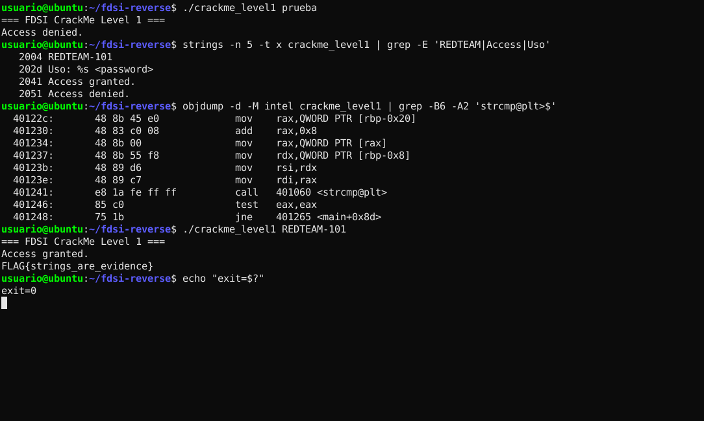

# Nivel 1: "Strings are evidence"

**Binario:** `crackme_level1` · SHA-256 `61e980febe84b1003b5a3b641468e915b984f7fdd835be9828af54233f88c68c` (verificado, ver [`baseline.txt`](baseline.txt))
**Herramientas:** `file`, `strings`, `objdump`, ejecución controlada
**Resultado:** contraseña `REDTEAM-101` → `FLAG{strings_are_evidence}`

Seguimos el método **observación → hipótesis → evidencia → confirmación**. No se abrió ni se solicitó el código fuente.

---

## 1. Observación: ejecutar con datos falsos

Antes de mirar el binario por dentro, observamos cómo se comporta desde fuera ([`raw/level1_runs.txt`](raw/level1_runs.txt)):

```text
$ ./crackme_level1
=== FDSI CrackMe Level 1 ===
Uso: ./crackme_level1 <password>
[exit=1]

$ ./crackme_level1 prueba
=== FDSI CrackMe Level 1 ===
Access denied.
[exit=2]
```

Qué aprendimos:

- La contraseña llega como **primer argumento** (`argv[1]`).
- Hay **tres caminos** de salida con códigos distintos: `1` = uso incorrecto, `2` = denegado y, por deducción, otro código para el acceso concedido.
- Los mensajes son texto fijo, así que deberían estar en `.rodata`.

## 2. Análisis estático con `strings`

```bash
strings -n 5 -t x crackme_level1 | less      # -t x: muestra el offset de cada cadena
```

Extracto relevante ([`raw/level1_strings.txt`](raw/level1_strings.txt)):

```text
   2004 REDTEAM-101
   2010 === FDSI CrackMe Level 1 ===
   202d Uso: %s <password>
   2041 Access granted.
   2051 Access denied.
```

Observaciones:

1. `Access granted.` y `Access denied.` son los mensajes de éxito y fracaso.
2. **`REDTEAM-101`** está en el offset `0x2004`, **justo antes** del banner y de los mensajes. No es texto que se muestre en pantalla (nunca lo vimos al ejecutar), así que es un dato **interno** del programa.
3. En la tabla de imports aparecen `strcmp`, `printf`, `puts` y `putchar`. Que esté `strcmp` sugiere una comparación directa de cadenas.
4. En los símbolos (el binario **no está stripped** y tiene `debug_info`) aparecen `print_flag` y hasta la ruta del código fuente `/mnt/data/reverse_fsi_lab/crackme_level1.c` y las banderas de compilación `-g -O0`.

El volcado de `.rodata` confirma la disposición ([`raw/level1_rodata.txt`](raw/level1_rodata.txt)):

```text
 402000 01000200 52454454 45414d2d 31303100  ....REDTEAM-101.
 402010 3d3d3d20 46445349 20437261 636b4d65  === FDSI CrackMe
```

## 3. Hipótesis

> **H1:** el programa compara `argv[1]` con la constante `"REDTEAM-101"` usando `strcmp`. Si son iguales, imprime `Access granted.` y llama a `print_flag()`.

Siguiendo la pista de la guía, no buscamos la FLAG directamente. Buscamos **qué dato se compara antes del camino de éxito**.

## 4. Evidencia: desensamblado de `main`

```bash
objdump -d -M intel crackme_level1 | less
```

Fragmento de `main` ([`raw/level1_objdump.txt`](raw/level1_objdump.txt)) con nuestras anotaciones:

```asm
4011e7: lea    rax,[rip+0xe16]        # 402004  -> dirección de "REDTEAM-101"
4011ee: mov    QWORD PTR [rbp-0x8],rax          ; password = "REDTEAM-101"
...
401201: cmp    DWORD PTR [rbp-0x14],0x2         ; if (argc != 2)
401205: je     40122c                           ;   -> imprime "Uso: ..." y retorna 1
...
40122c: mov    rax,QWORD PTR [rbp-0x20]         ; argv
401230: add    rax,0x8
401234: mov    rax,QWORD PTR [rax]              ; rax = argv[1]
401237: mov    rdx,QWORD PTR [rbp-0x8]          ; rdx = password
40123b: mov    rsi,rdx                          ; 2.º argumento = "REDTEAM-101"
40123e: mov    rdi,rax                          ; 1.er argumento = argv[1]
401241: call   401060 <strcmp@plt>              ; strcmp(argv[1], "REDTEAM-101")
401246: test   eax,eax
401248: jne    401265                           ; distinto de 0 -> "Access denied." (ret 2)
40124a: lea    rax,[rip+0xdf0]        # 402041  -> "Access granted."
401254: call   401040 <puts@plt>
401259: call   401156 <print_flag>              ; camino de éxito
40125e: mov    eax,0x0                          ; return 0
```

La dirección `0x402004` que se carga en `[rbp-0x8]` es exactamente la de `REDTEAM-101` en `.rodata`. Según la convención System V AMD64, `rdi` y `rsi` son el primer y el segundo argumento, así que la llamada es literalmente `strcmp(argv[1], "REDTEAM-101")`. **H1 queda respaldada por el código.**

### Pseudocódigo propio

```c
int main(int argc, char **argv) {
    const char *password = "REDTEAM-101";      // secreto embebido en .rodata
    puts("=== FDSI CrackMe Level 1 ===");
    if (argc != 2) { printf("Uso: %s <password>\n", argv[0]); return 1; }
    if (strcmp(argv[1], password) == 0) {       // comparación directa en texto plano
        puts("Access granted.");
        print_flag();                           // descifra e imprime la FLAG
        return 0;
    }
    puts("Access denied.");
    return 2;
}
```

## 5. Confirmación por ejecución

```text
$ ./crackme_level1 REDTEAM-101
=== FDSI CrackMe Level 1 ===
Access granted.
FLAG{strings_are_evidence}
[exit=0]

$ ./crackme_level1 redteam-101          # control negativo: strcmp distingue mayúsculas
=== FDSI CrackMe Level 1 ===
Access denied.
[exit=2]
```

**FLAG Nivel 1: `FLAG{strings_are_evidence}`**



## 6. Hallazgo adicional: la FLAG no estaba en `strings`, pero tampoco estaba protegida

`strings` no muestra `FLAG{...}`. Al revisar `print_flag` vimos por qué:

```asm
40115e: movabs rax,0x282e29211d1b161c     ; bytes cifrados guardados como inmediatos
...
401196: mov    BYTE PTR [rbp-0x9],0x5a    ; clave XOR = 0x5a
4011b2: xor    al,BYTE PTR [rbp-0x9]      ; buf[i] ^ 0x5a
4011ba: call   putchar                    ; imprime carácter a carácter (26 bytes)
```

La FLAG está **ofuscada con un XOR de un solo byte (`0x5a`)** y guardada dentro de las instrucciones (`movabs`), no en `.rodata`. Por eso `strings` no la ve. Pero la ofuscación no es cifrado: con los inmediatos y la clave, el script [`scripts/decode_level1_flag.py`](../../../scripts/decode_level1_flag.py) la recupera sin ejecutar el binario:

```text
$ python3 scripts/decode_level1_flag.py
FLAG{strings_are_evidence}
```

## 7. ¿Por qué `strings` revela secretos embebidos?

- Un literal de C (`"REDTEAM-101"`) se compila **tal cual**, en ASCII y terminado en `\0`, dentro de la sección de solo lectura `.rodata`. El compilador no lo cifra ni lo transforma.
- `strings` solo recorre el archivo buscando secuencias de N o más bytes imprimibles seguidas. No necesita entender el formato ELF, ni ejecutar el programa, ni tener permisos especiales. Cualquiera que tenga el binario puede hacerlo.
- Un binario que se distribuye queda **en manos del atacante**: todo lo que el programa "sabe" (contraseñas, claves API, URLs internas) se puede extraer. Un secreto compilado deja de ser secreto en cuanto se distribuye el ejecutable.
- Lo único que hizo falta para la contraseña fue `strings`. Para la FLAG bastó un `objdump`. Ninguna de las dos protecciones resiste un análisis estático básico.

## 8. Lecciones de desarrollo seguro (Nivel 1)

| Problema observado | Control recomendado |
|---|---|
| Contraseña literal en `.rodata` | No guardar secretos en el binario. Validar en un servidor o guardar solo un **hash con sal y función lenta** (Argon2id, bcrypt) |
| `strcmp` en el cliente decide el acceso | La decisión de autorización debe tomarla un componente **confiable**, no el ejecutable que controla el usuario |
| FLAG "oculta" con XOR de 1 byte | La ofuscación no es cifrado. Si el binario contiene la clave, el atacante también la tiene |
| Binario con `debug_info` y ruta del fuente | Compilar las versiones de release sin `-g` y aplicar `strip` (higiene, no un control de seguridad) |
