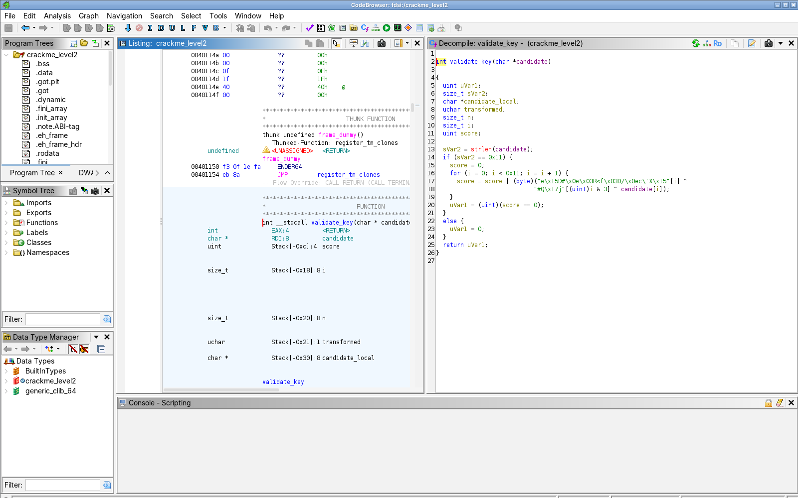
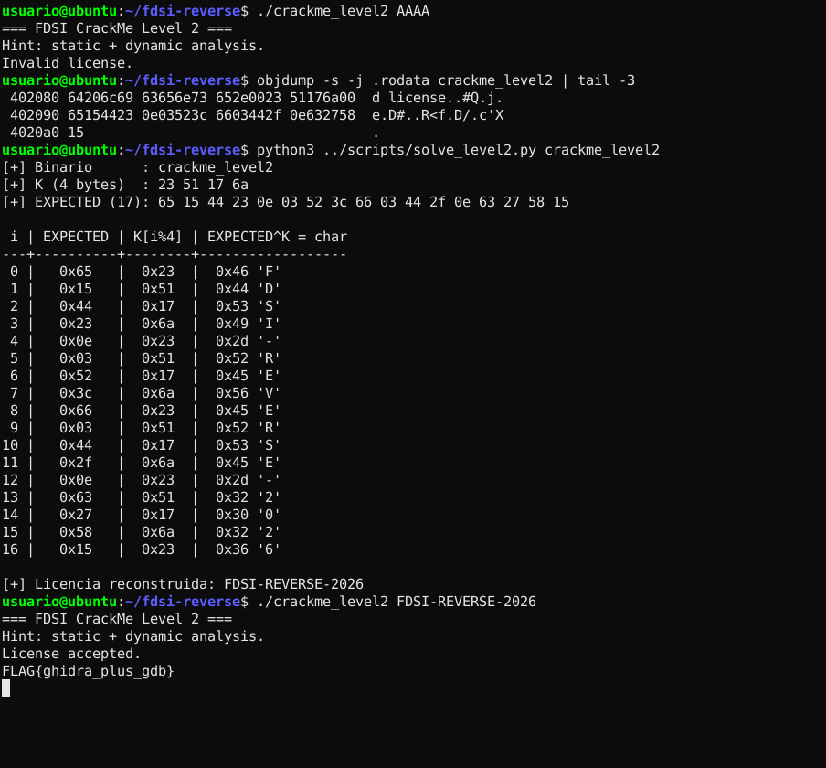

# Nivel 2: reconstrucción de la validación con Ghidra

**Binario:** `crackme_level2` · SHA-256 `8dc5931dfbf74d7371de9ca9ed8cc57bfe0af4521346202dcd1c701dd8b6f4e5` (verificado)
**Herramientas:** Ghidra 11.3.2 (proyecto *Non-Shared* `fdsi`, análisis automático por defecto), `strings`, `objdump`
**Resultado:** licencia `FDSI-REVERSE-2026` → `FLAG{ghidra_plus_gdb}`

---

## 1. Observación inicial

```text
$ ./crackme_level2
=== FDSI CrackMe Level 2 ===
Hint: static + dynamic analysis.
Uso: ./crackme_level2 <license-key>          [exit=1]

$ ./crackme_level2 AAAA
...
Invalid license.                             [exit=3]
```

`strings -n 5 crackme_level2` ya **no** muestra ninguna cadena que parezca una licencia. Solo aparecen los mensajes (`License accepted.`, `Invalid license.`), los imports (`strlen`, `puts`, `putchar`, `printf`) y, como el binario tiene símbolos, los nombres `validate_key`, `reveal_flag` y `expected`. El import `strlen` (que en el Nivel 1 no estaba) indica que la **longitud** de la clave importa. Al no aparecer `strcmp`, la comparación debe ser manual.

## 2. Proceso en Ghidra

1. **File → New Project → Non-Shared Project** `fdsi`. Importamos `crackme_level2` y aceptamos el análisis automático con las opciones por defecto. Captura: [`screenshots/01_ghidra_proyecto_non_shared.png`](screenshots/01_ghidra_proyecto_non_shared.png)
2. **Symbol Tree → Functions → `main`**. El decompilador muestra que `main` verifica `argc == 2` y que el valor de retorno de **`validate_key(argv[1])`** decide entre `"License accepted."` + `reveal_flag()` y `"Invalid license."`. Captura: [`screenshots/02_ghidra_level2_main.png`](screenshots/02_ghidra_level2_main.png)
3. Doble clic en `validate_key`. Esta es la rutina que decide si la licencia es válida. Captura: [`screenshots/03_ghidra_level2_validate_key.png`](screenshots/03_ghidra_level2_validate_key.png)
4. Doble clic en los dos arreglos que usa (`k.1` en `0x40208b` y `expected.0` en `0x402090`) para ver sus bytes en el *Listing*. Captura: [`screenshots/04_ghidra_level2_rodata_k_expected.png`](screenshots/04_ghidra_level2_rodata_k_expected.png)

Decompilado de Ghidra de `validate_key`, **tal como sale** ([`raw/ghidra_crackme_level2.c`](raw/ghidra_crackme_level2.c)):

```c
int validate_key(char *candidate)
{
  uint uVar1;
  size_t sVar2;
  ...
  sVar2 = strlen(candidate);
  if (sVar2 == 0x11) {
    score = 0;
    for (i = 0; i < 0x11; i = i + 1) {
      score = score | (byte)("e\x15D#\x0e\x03R<f\x03D/\x0ec\'X\x15"[i] ^
                            "#Q\x17j"[(uint)i & 3] ^ candidate[i]);
    }
    uVar1 = (uint)(score == 0);
  }
  else {
    uVar1 = 0;
  }
  return uVar1;
}
```



> Ghidra muestra los arreglos como literales de cadena porque algunos de sus bytes son imprimibles (`"#Q\x17j"` = `23 51 17 6a`). Por eso `strings` no los destaca: son datos binarios, no texto.

## 3. Interpretación paso a paso

| Elemento en Ghidra / ensamblador | Qué significa | Nombre que le dimos |
|---|---|---|
| `strlen(candidate)` comparado con `0x11` (`mov QWORD PTR [rbp-0x18],0x11` / `cmp`) | **La clave debe tener exactamente 17 caracteres.** Si no, retorna 0 sin mirar el contenido | `KEY_LEN = 17` |
| `"#Q\x17j"` en `0x40208b`, `uchar[4]` | Clave XOR de **4 bytes**: `23 51 17 6a` | `XOR_KEY_4B` |
| `[(uint)i & 3]` (`and eax,0x3`) | `i & 3` es `i % 4`: el arreglo de 4 bytes **se reutiliza de forma cíclica** (pista 1 de la guía) | - |
| `"e\x15D#..."` en `0x402090`, `uchar[17]` | Valores **esperados** después de transformar: `65 15 44 23 0e 03 52 3c 66 03 44 2f 0e 63 27 58 15` | `EXPECTED_17B` |
| `candidate[i] ^ k[i&3]` (`xor eax,ecx` → `[rbp-0x19]`) | **Transformación de cada byte: XOR** (reversible, pista 2) | `transformed` |
| `expected[i] ^ transformed` (`xor al,[rbp-0x19]`) | Vale 0 solo si `transformed == expected[i]` | - |
| `score \|= ...` (`or DWORD PTR [rbp-0x4],eax`) | Acumula cualquier diferencia. **No sale antes de tiempo** del bucle | `diff_acc` |
| `return score == 0` (`sete al`) | 1 = licencia válida, 0 = inválida | `is_valid` |

Variables y funciones renombradas en el proyecto (en el binario stripped tuvimos que asignar todos los nombres nosotros, ver Boss Level):

| Original Ghidra | Renombre | Motivo |
|---|---|---|
| `validate_key` / `FUN_00401156` | `check_license` | Recibe `argv[1]` y su retorno decide el camino de éxito |
| `reveal_flag` / `FUN_004011f3` | `print_secret_flag` | 21 bytes XOR `0x37` → `putchar` |
| `k.1` / `DAT_0040208b` | `XOR_KEY_4B` | Se indexa con `i & 3` y se aplica XOR a la entrada |
| `expected.0` / `DAT_00402090` | `EXPECTED_17B` | Se compara contra la entrada transformada |
| `param_1` / `candidate` | `user_key` | Primer argumento (`rdi`) = `argv[1]` |
| `sVar2` | `key_len` | Resultado de `strlen` |
| `bVar1` / `score` | `diff_acc` | Acumulador OR de diferencias |
| `local_18` | `i` | Contador del bucle |

## 4. Pseudocódigo propio del algoritmo

```text
FUNCIÓN check_license(user_key):
    XOR_KEY_4B   ← [0x23, 0x51, 0x17, 0x6A]                  // 4 bytes, uso cíclico
    EXPECTED_17B ← [0x65, 0x15, 0x44, 0x23, 0x0E, 0x03, 0x52, 0x3C, 0x66,
                    0x03, 0x44, 0x2F, 0x0E, 0x63, 0x27, 0x58, 0x15]

    SI longitud(user_key) ≠ 17 ENTONCES
        RETORNAR falso                                       // descarte rápido por longitud

    diff_acc ← 0
    PARA i DESDE 0 HASTA 16:
        transformado ← user_key[i] XOR XOR_KEY_4B[i mod 4]   // transformación por byte
        diff_acc     ← diff_acc OR (transformado XOR EXPECTED_17B[i])
                                                             // ≠0 si algún byte no coincide
    RETORNAR (diff_acc = 0)
```

Condición de aceptación, en una línea:

```text
∀ i ∈ [0,16]:  user_key[i] ⊕ K[i mod 4] = E[i]
```

## 5. Reconstrucción de la clave (invertir el XOR)

XOR es su propia inversa: `(a ⊕ b) ⊕ b = a`. Si despejamos:

```text
user_key[i] = E[i] ⊕ K[i mod 4]
```

| i | E[i] | K[i mod 4] | E⊕K | char |
|--:|:--:|:--:|:--:|:--:|
| 0 | 0x65 | 0x23 | 0x46 | F |
| 1 | 0x15 | 0x51 | 0x44 | D |
| 2 | 0x44 | 0x17 | 0x53 | S |
| 3 | 0x23 | 0x6a | 0x49 | I |
| 4 | 0x0e | 0x23 | 0x2d | - |
| 5 | 0x03 | 0x51 | 0x52 | R |
| 6 | 0x52 | 0x17 | 0x45 | E |
| 7 | 0x3c | 0x6a | 0x56 | V |
| 8 | 0x66 | 0x23 | 0x45 | E |
| 9 | 0x03 | 0x51 | 0x52 | R |
| 10 | 0x44 | 0x17 | 0x53 | S |
| 11 | 0x2f | 0x6a | 0x45 | E |
| 12 | 0x0e | 0x23 | 0x2d | - |
| 13 | 0x63 | 0x51 | 0x32 | 2 |
| 14 | 0x27 | 0x17 | 0x30 | 0 |
| 15 | 0x58 | 0x6a | 0x32 | 2 |
| 16 | 0x15 | 0x23 | 0x36 | 6 |

**Licencia: `FDSI-REVERSE-2026`** (17 caracteres)

El cálculo se automatizó en [`scripts/solve_level2.py`](../../../scripts/solve_level2.py). El script lee `K` y `E` directamente del ELF (traduce la dirección virtual a offset de archivo con los *program headers*) y comprueba la transformación hacia adelante. Salida en [`raw/solve_level2_output.txt`](raw/solve_level2_output.txt). Funciona igual con el binario stripped.

## 6. Confirmación por ejecución

```text
$ ./crackme_level2 FDSI-REVERSE-2026
=== FDSI CrackMe Level 2 ===
Hint: static + dynamic analysis.
License accepted.
FLAG{ghidra_plus_gdb}
[exit=0]
```

**FLAG Nivel 2: `FLAG{ghidra_plus_gdb}`**

La confirmación dinámica byte a byte (registros, acumulador y valor de retorno) está en [`gdb.md`](gdb.md).



## 7. Complemento fuera de Ghidra

```bash
objdump -s -j .rodata crackme_level2
```
Salida real ([`raw/level2_rodata.txt`](raw/level2_rodata.txt)):

```text
 402080 64206c69 63656e73 652e0023 51176a00  d license..#Q.j.   ← 0x40208b: K = 23 51 17 6a
 402090 65154423 0e03523c 6603442f 0e632758  e.D#..R<f.D/.c'X   ← 0x402090: EXPECTED[0..15]
 4020a0 15                                   .                  ← EXPECTED[16]
```

Con `objdump` también se llega a la respuesta, pero hay que reconstruir mentalmente el flujo de pila (`[rbp-0x10]` = i, `[rbp-0x19]` = transformado, `[rbp-0x4]` = acumulador). Ghidra lo hace por nosotros: convierte `and eax,0x3` en un índice `i & 3` y el bucle en un `for`. Así el algoritmo se entiende en segundos y no en minutos (ver pregunta 4 del informe).

## 8. Observaciones de seguridad

1. **La clave sigue embebida, solo que transformada.** Guardar `E` y `K` en el mismo binario equivale a guardar la contraseña: basta un XOR para recuperarla.
2. **La validación ocurre en el cliente.** `main` solo mira si `eax` es 0 o 1. En [`gdb.md`](gdb.md) (sesión 4) forzamos `eax = 1` con una clave inválida y obtuvimos la FLAG. **No hace falta conocer la clave.**
3. **La FLAG ni siquiera depende de la clave:** `reveal_flag` la descifra con un XOR fijo de 1 byte (`0x37`) sobre 21 bytes constantes. Se puede leer estáticamente sin resolver la validación.
4. **Un punto positivo:** el acumulador `OR` recorre los 17 bytes siempre (no sale en el primer error), lo que reduce un canal lateral de tiempo. Pero no compensa los puntos anteriores.
5. Los símbolos y la información DWARF (`validate_key`, `expected`, `candidate`, `score`, ruta del `.c`) le regalaron al analista los nombres de todo. El Boss Level muestra que incluso sin ellos el resultado es el mismo.
