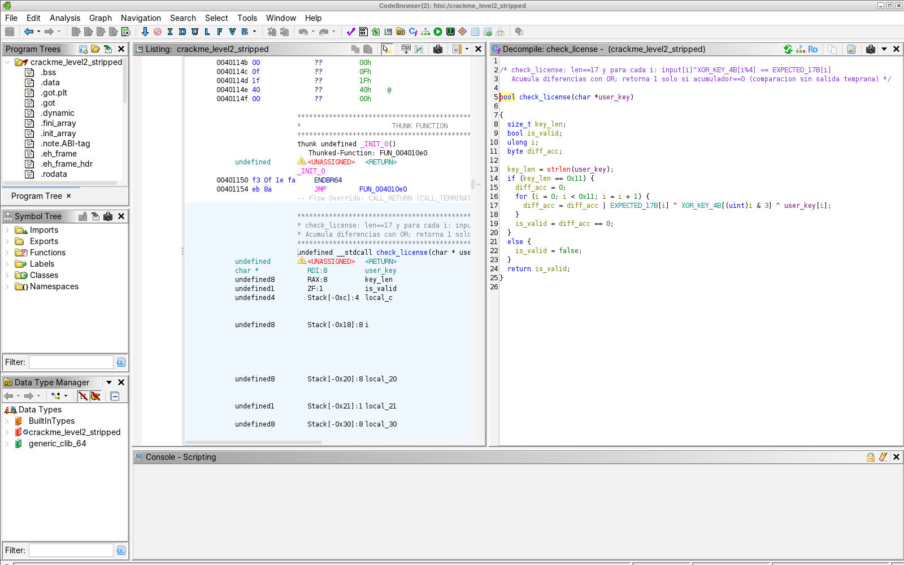

# Informe Lab 04 Parte 2: Reverse Engineering Challenge

**Curso:** FDSI · 2026-2 · Escuela Colombiana de Ingeniería Julio Garavito
**Equipo:** Marlio José Charry Espitia · David Alejandro Patacón Henao
**Ruta:** alternativa local (CTF de ingeniería inversa). No se publicó ningún servicio.
**Alcance:** solo los tres crackmes académicos entregados por el docente, con hashes verificados. **No se abrió ni se solicitó el código fuente.**

---

## Resumen ejecutivo

| Nivel | Técnica decisiva | Hallazgo | Resultado |
|---|---|---|---|
| 1 · Recon | `strings` + `objdump` | Contraseña literal en `.rodata` comparada con `strcmp` | `REDTEAM-101` → **`FLAG{strings_are_evidence}`** |
| 2 · Decompile | Ghidra + GDB | Longitud 17. Cada byte se transforma con XOR contra una clave cíclica de 4 bytes y se compara con un arreglo esperado | `FDSI-REVERSE-2026` → **`FLAG{ghidra_plus_gdb}`** |
| Boss · Stripped | XREFs de strings, `entry` → `__libc_start_main`, firma de la rutina | Misma lógica en las mismas direcciones. El strip solo borró nombres | Misma licencia y misma FLAG |

Además se demostró que la validación se puede **saltar sin conocer la clave** (forzando `eax = 1` en GDB) y que las FLAG están ofuscadas con XOR de un solo byte, así que se pueden leer estáticamente.

Detalle por nivel: [`level1.md`](docs/evidence/reverse/level1.md) · [`level2.md`](docs/evidence/reverse/level2.md) · [`gdb.md`](docs/evidence/reverse/gdb.md) · [`baseline.txt`](docs/evidence/reverse/baseline.txt)

---

## 1. Preparación y baseline forense

### Entorno

| Elemento | Valor |
|---|---|
| SO de análisis | Ubuntu 24.04 x86-64 |
| Herramientas | `file 5.45`, GNU `binutils 2.42` (readelf, objdump, strings, nm), `GNU gdb 15.1`, **Ghidra 11.3.2** (distribución oficial de GitHub, NSA) sobre OpenJDK 21 |
| Directorio de trabajo | `binaries/` (copia de los 3 ejecutables) |

### Identificación de los binarios (`file`, `readelf -h`)

| Propiedad | `crackme_level1` | `crackme_level2` | `crackme_level2_stripped` |
|---|---|---|---|
| Formato | ELF64, little-endian | ELF64 | ELF64 |
| Arquitectura | x86-64 (`Advanced Micro Devices X86-64`) | x86-64 | x86-64 |
| Tipo | `EXEC` (sin PIE, base `0x400000`) | `EXEC` | `EXEC` |
| Entry point | `0x401070` | `0x401070` | `0x401070` |
| Linking | **Dinámico** (`libc.so.6`, `ld-linux-x86-64.so.2`) | Dinámico | Dinámico |
| Símbolos (`.symtab`) | **Sí** | **Sí** | **No** (`nm: no symbols`) |
| Info. de depuración (DWARF) | **Sí** (`with debug_info`) | **Sí** | **No** |
| Compilador | GCC 14.2.0 (Debian), `-g -O0` | GCC 14.2.0 | GCC 14.2.0 |
| Protecciones | Sin PIE, sin stack canary, RELRO parcial, NX activo (pila `RW`) | Igual | Igual |
| Tamaño | 17 760 B | 18 200 B | 14 424 B |

### Integridad (`sha256sum`)

```text
61e980febe84b1003b5a3b641468e915b984f7fdd835be9828af54233f88c68c  crackme_level1          OK
8dc5931dfbf74d7371de9ca9ed8cc57bfe0af4521346202dcd1c701dd8b6f4e5  crackme_level2          OK
c8e638741272a87ee3b30fe8878898c1aa977e6a879a1ec0b271034b5bb9aed3  crackme_level2_stripped OK
```

Los tres coinciden con los hashes publicados en la guía (`sha256sum -c`, ver [`baseline.txt`](docs/evidence/reverse/baseline.txt)).

### ¿Por qué un hash garantiza que todos analizan el mismo binario?

SHA-256 es una función hash criptográfica: produce un resumen de 256 bits que cambia por completo si se altera **un solo bit** del archivo (efecto avalancha). Además, es computacionalmente inviable encontrar otro archivo con el mismo resumen (resistencia a segunda preimagen y a colisiones). Por eso:

- **Reproducibilidad:** si nuestro hash coincide con el del docente, las direcciones (`0x401156`, `0x402090`…), los bytes y los resultados de este informe son comparables con los de cualquier otro equipo.
- **Integridad y cadena de custodia:** descarta que el archivo se haya corrompido al descargarlo o al descomprimir el `.zip`, o que alguien lo haya modificado (por ejemplo, un binario parchado o con malware).
- **Identidad de la evidencia:** en forense digital, el hash se registra **antes** de analizar, para demostrar después que la evidencia no cambió durante el análisis.

> Un hash garantiza **integridad**, no **autenticidad**: si un atacante cambia el binario *y* el hash publicado, el hash no lo detecta. Para eso se usan firmas digitales (GPG, Sigstore).

---

## 2. Nivel 1: Recon (resumen)

1. **Observación:** `./crackme_level1 prueba` → `Access denied.` (exit 2). La contraseña llega por `argv[1]`.
2. **Evidencia estática:** `strings` muestra `REDTEAM-101` en el offset `0x2004` de `.rodata`, justo antes de los mensajes `Access granted.` / `Access denied.`. Entre los imports está `strcmp`.
3. **Hipótesis:** `strcmp(argv[1], "REDTEAM-101") == 0` → éxito.
4. **Confirmación en el código:** en `main`, `lea rax,[rip+0xe16] # 402004` → `rsi`, `argv[1]` → `rdi`, `call strcmp@plt`, `jne` → denegado.
5. **Confirmación por ejecución:** `./crackme_level1 REDTEAM-101` → `Access granted.` + **`FLAG{strings_are_evidence}`**.
6. **Extra:** la FLAG no aparece en `strings` porque `print_flag` la arma con inmediatos `movabs` y la descifra con XOR `0x5a`. [`scripts/decode_level1_flag.py`](scripts/decode_level1_flag.py) la recupera sin ejecutar el binario.

Detalle completo: [`docs/evidence/reverse/level1.md`](docs/evidence/reverse/level1.md)

## 3. Nivel 2: Decompile (resumen)

- **Ghidra:** `main` → `validate_key(argv[1])` decide el camino.
- **Longitud esperada:** `strlen(key) == 0x11` → **17**.
- **Transformación por byte:** `key[i] XOR K[i & 3]`, con `K = 23 51 17 6a` en `0x40208b` (arreglo de 4 bytes reutilizado de forma cíclica).
- **Comparación:** contra `E[17]` en `0x402090`, acumulando diferencias con `OR` (`return acc == 0`).
- **Inversión:** `key[i] = E[i] XOR K[i % 4]` → **`FDSI-REVERSE-2026`** → **`FLAG{ghidra_plus_gdb}`**.

Pseudocódigo propio:

```text
check_license(key):
    si len(key) ≠ 17: retornar falso
    acc ← 0
    para i en 0..16:  acc ← acc OR ((key[i] XOR K[i mod 4]) XOR E[i])
    retornar acc = 0
```

Detalle completo, tabla de renombres y tabla de inversión byte a byte: [`docs/evidence/reverse/level2.md`](docs/evidence/reverse/level2.md)

## 4. Confirmación dinámica con GDB (resumen)

| Prueba | Observación en GDB | Conclusión |
|---|---|---|
| `AAAA` | `rax = 4` frente a `[rbp-0x18] = 0x11` → `eax = 0` sin entrar al bucle | Primera condición: longitud 17 |
| `A`×17 | En `i=0`: `eax = 0x07` (`0x41^0x23^0x65`). `score` final `0x7f` → `eax = 0` | La transformación XOR y el OR acumulado funcionan como se dedujo |
| `FDSI-REVERSE-2026` | En las 17 iteraciones, `transformado == expected`. `score = 0` → **`eax = 1`** | Hipótesis confirmada |
| Clave inválida + `set $eax = 1` | `License accepted.` + FLAG | El control se salta modificando un registro |

Detalle: [`docs/evidence/reverse/gdb.md`](docs/evidence/reverse/gdb.md)

---

## 5. Boss Level: binario sin símbolos

### 5.1 Qué desapareció al hacer `strip`

Evidencia: [`raw/strip_diff.txt`](docs/evidence/reverse/raw/strip_diff.txt)

| Desapareció | Consecuencia para el analista |
|---|---|
| `.symtab` y `.strtab` (35 símbolos → `nm: no symbols`) | No quedan los nombres `main`, `validate_key`, `reveal_flag`, `expected.0`, `k.1`. Ghidra muestra `FUN_00401156` y `DAT_00402090`. `break validate_key` deja de funcionar en GDB |
| `.debug_info`, `.debug_line`, `.debug_str`, `.debug_abbrev`, `.debug_aranges`, `.debug_line_str` (DWARF) | Ya no hay nombres de variables ni parámetros (`candidate`, `score`, `transformed`), tipos, números de línea ni la ruta del `.c`. Ghidra vuelve a `param_1`, `local_18`, `bVar1` |
| ~3,7 KB (18 200 → 14 424 B) | - |

| **No** desapareció | Por qué importa |
|---|---|
| `.text` y `.rodata` **idénticos** (mismo SHA-256 de sección) | La lógica, las constantes `0x11`, `K` y `E` siguen en las **mismas direcciones** |
| Strings de usuario (`Invalid license.`, `License accepted.`…) | Funcionan como puntos de referencia para navegar el binario |
| `.dynsym` (imports: `strlen`, `puts`, `putchar`, `printf`, `__libc_start_main`) | El loader los necesita. Indican qué hace cada función (por ejemplo, la que llama a `strlen`) |
| Entry point `0x401070` | Punto de partida garantizado |

> **Conclusión:** `strip` reduce el tamaño y quita comodidad, pero **no protege la lógica**. Es higiene de release, no un control de seguridad.

### 5.2 Cómo se volvió a encontrar la validación (sin usar nombres)

Usamos tres caminos independientes que llegan a la misma función:

**Camino A: strings y referencias cruzadas (XREFs)**

1. `strings -n 5 crackme_level2_stripped` → `Invalid license.` y `License accepted.` siguen ahí.
2. En Ghidra: *Window → Defined Strings*, y en cada string, *References → Show References to*. Ambas cadenas solo se usan desde **`FUN_00401267`** ([`raw/ghidra_crackme_level2_stripped.c`](docs/evidence/reverse/raw/ghidra_crackme_level2_stripped.c)):
   ```text
   0040207a  "Invalid license."   <- 004012f1(FUN_00401267) 004012f8(FUN_00401267)
   00402068  "License accepted."  <- 004012d6(FUN_00401267) 004012dd(FUN_00401267)
   ```
3. En `FUN_00401267`, la condición que separa ambos mensajes es el retorno de **`FUN_00401156(param_2[1])`**. Esa es la rutina de validación.

**Camino B: flujo de ejecución desde el entry point**

1. `readelf -h` → entry `0x401070`.
2. `entry` prepara los argumentos de `__libc_start_main`. Su 1.er argumento (`rdi`) es la dirección de `main`:
   ```asm
   401084: mov    rdi,0x401267                 ; main
   40108b: call   QWORD PTR [rip+0x2f47]       ; __libc_start_main (vía GOT)
   ```
   Captura: [`screenshots/05_boss_entry_libc_start_main.png`](docs/evidence/reverse/screenshots/05_boss_entry_libc_start_main.png)
3. En `main` (`0x401267`): `argv[1]` → `rdi` → `call 0x401156` → `test eax,eax` / `je` → mensajes de éxito o fracaso.

**Camino C: firma de comportamiento en el ensamblador**

- Solo una función llama a `strlen@plt` (`0x401171`) y compara el resultado con la constante `0x11`.
- La misma función tiene un bucle con `and eax,0x3` (índice cíclico) + `xor` + `or` acumulado + `sete al`. Es el patrón que identificamos en el Nivel 2.

> **Cuidado con objdump sin símbolos:** `objdump` etiqueta `call 401156` como `<printf@plt+0xf6>`, porque toma el símbolo más cercano que conoce. Esa etiqueta es **engañosa**: la dirección no tiene relación con `printf`. Hay que fiarse de la dirección, no del nombre.

### 5.3 Renombres aplicados en Ghidra

Aplicados con [`scripts/AnnotateStripped.java`](scripts/AnnotateStripped.java), que equivale a renombrar a mano con la tecla `L`:

| Original | Renombre |
|---|---|
| `FUN_00401267` | `main_recovered` |
| `FUN_00401156` | `check_license` |
| `FUN_004011f3` | `print_secret_flag` |
| `DAT_0040208b` | `XOR_KEY_4B` (`byte[4]`) |
| `DAT_00402090` | `EXPECTED_17B` (`byte[17]`) |
| `param_1` / `sVar2` / `bVar1` / `local_18` | `user_key` / `key_len` / `diff_acc` / `i` |



Más evidencia: [`screenshots/07_boss_main_recovered.png`](docs/evidence/reverse/screenshots/07_boss_main_recovered.png), [`raw/ghidra_stripped_annotated.c`](docs/evidence/reverse/raw/ghidra_stripped_annotated.c)

### 5.4 Confirmación

- `python3 scripts/solve_level2.py binaries/crackme_level2_stripped` → `FDSI-REVERSE-2026`
- GDB con `break *0x401156` (por dirección): clave válida → `eax = 1`. Clave inválida de 17 bytes → `eax = 0` ([`gdb.md`](docs/evidence/reverse/gdb.md#sesión-5-boss-mismo-análisis-sin-símbolos)).

---

## 6. Preguntas de análisis

**1. ¿Qué información pudiste obtener sin ejecutar el binario?**
Prácticamente toda:
- Con `file` y `readelf`: formato, arquitectura, linking, entry point y protecciones.
- Con `sha256sum`: la identidad de cada archivo.
- Con `strings`: la contraseña del Nivel 1, los mensajes, los imports y, en los binarios no stripped, los nombres de funciones, la ruta del código fuente y el compilador con sus banderas.
- Con `objdump` y Ghidra: el algoritmo completo de validación, la clave XOR, el arreglo esperado y la longitud.

Con eso se reconstruyeron **las dos claves y las dos FLAG sin ejecutar nada** (`solve_level2.py`, `decode_level1_flag.py`). La ejecución solo sirvió para confirmar.

**2. ¿Por qué una contraseña compilada como string es un diseño inseguro?**
Porque el compilador la guarda **en claro** en `.rodata`, y cualquier persona con el binario la extrae con `strings` en segundos, sin conocimientos especiales. El ejecutable se distribuye, así que queda en manos del atacante. Además, la contraseña es la misma para todas las copias y no se puede cambiar sin recompilar y redistribuir. Transformarla (XOR, como en el Nivel 2) no cambia el problema: si la clave y los datos viajan en el mismo binario, el secreto sigue ahí.

**3. ¿Qué cambió entre `crackme_level2` y `crackme_level2_stripped`?**
Se eliminaron `.symtab` y `.strtab` (nombres de funciones y variables globales) y las seis secciones `.debug_*` (DWARF: variables locales, tipos, líneas, ruta del fuente). El archivo pasó de 18 200 a 14 424 bytes. **El código (`.text`) y los datos (`.rodata`) son idénticos byte a byte.** Solo cambia la comodidad del análisis: `validate_key` pasa a ser `FUN_00401156` y `break validate_key` deja de funcionar en GDB. Ver §5.

**4. ¿Qué ventaja tuvo Ghidra sobre objdump?**
`objdump` solo muestra un desensamblado lineal. Ghidra hace análisis automático: identifica funciones, propaga tipos, resuelve **referencias cruzadas** (de qué función se usa cada string) y, sobre todo, **decompila**: convierte `mov [rbp-0x10]…/and eax,3/xor/or/jb` en un `for` legible con `candidate[i] ^ k[i & 3]`. También permite **renombrar y comentar**, y esas anotaciones se propagan a todo el proyecto. Sin símbolos, `objdump` hasta da etiquetas engañosas (`<printf@plt+0xf6>`), mientras que Ghidra crea `FUN_00401156` y deja navegar por XREFs. En resumen, la lógica se entendió en minutos en lugar de reconstruir la pila a mano.

**5. ¿Qué confirmó GDB que el análisis estático por sí solo no demostraba?**
- Que las direcciones y los valores leídos estáticamente son los que **realmente** se usan en ejecución (`K` y `E` en memoria).
- Que el bucle opera como se dedujo, **iteración por iteración** (`transformado == expected` en las 17 posiciones).
- Que el valor de retorno cambia de **0 a 1** según la entrada, y en qué punto exacto se rechaza cada clave (longitud o contenido).
- Que la decisión depende de **un solo registro** (`eax`): al forzarlo a 1, el programa entregó la FLAG con una clave inválida.

El análisis estático plantea hipótesis. GDB las convierte en hechos observados.

**6. ¿Por qué Burp Suite no es una herramienta de ingeniería inversa de binarios?**
Burp es un **proxy de interceptación HTTP/HTTPS**: se pone entre el navegador y el servidor para ver, modificar y repetir peticiones y respuestas (Proxy, Repeater). Trabaja sobre el **tráfico de red** de aplicaciones web, una capa de protocolo. No sabe abrir un ELF, no desensambla instrucciones, no decompila y no inspecciona registros ni memoria de un proceso. Además, nuestros crackmes no hacen ninguna conexión de red, así que no hay tráfico que interceptar. Burp analiza **lo que una aplicación dice**; Ghidra y GDB analizan **lo que un programa es y hace**. Son complementarios, no intercambiables (ver [`burp.md`](docs/evidence/reverse/burp.md)).

**7. ¿Qué controles de desarrollo evitarían embebidos inseguros de secretos en software real?**
- **No embeber secretos:** usar un gestor de secretos (Vault, AWS Secrets Manager, Azure Key Vault) o variables de entorno inyectadas en ejecución, nunca literales en el código.
- **Validar en el servidor:** licencias y autorización se verifican en un backend confiable o con **firmas asimétricas**. El binario solo lleva la clave **pública**: puede verificar, pero no fabricar licencias.
- **Hashes lentos con sal** (Argon2id, bcrypt) si hay que comparar contraseñas localmente, y comparación en **tiempo constante**.
- **Escaneo de secretos** en el pipeline: hooks de pre-commit y CI con `gitleaks`, `trufflehog` o GitHub Secret Scanning. Revisión de código y SAST.
- **Revisión del artefacto final:** paso de CI que corra `strings`/`readelf` y busque patrones de secretos. Builds de release sin `-g`, con `strip` y con protecciones (PIE, RELRO completo, canaries).
- **Rotación y revocación:** asumir que cualquier secreto distribuido se va a filtrar y poder cambiarlo sin redistribuir el software.
- **No confiar en la ofuscación** (XOR, Base64, packers) como control de seguridad: solo retrasa al atacante.

---

## 7. Lecciones de desarrollo seguro

1. **Lo que se distribuye, se revisa.** Todo lo que el binario "sabe", el atacante también lo sabe.
2. **Ofuscar no es cifrar.** Las dos FLAG usaban XOR de un byte y la clave del Nivel 2 un XOR de 4 bytes. Ninguno resistió un análisis básico.
3. **Las decisiones de seguridad del lado del cliente se pueden saltar.** Bastó cambiar `eax` en GDB.
4. **Los símbolos y el DWARF regalan contexto** (nombres, ruta del fuente, compilador). Compilar los releases sin `-g` y con `strip`, pero sin creer que eso protege la lógica.
5. **Método antes que herramienta:** observar → formular hipótesis → buscar evidencia estática → confirmar dinámicamente → documentar.

---

## 8. Módulo complementario: Burp Suite

Procedimiento y comparación entre análisis web e ingeniería inversa: [`docs/evidence/reverse/burp.md`](docs/evidence/reverse/burp.md)

## 9. Síntesis para el cierre

| Punto | Respuesta |
|---|---|
| Qué observamos | Los hashes coinciden con la guía. Son ELF x86-64 dinámicos, sin PIE; los dos primeros con símbolos y DWARF, el tercero stripped. La clave llega por `argv[1]` y cada camino sale con un código distinto |
| Qué hipótesis formulamos | Nivel 1: `strcmp` contra `REDTEAM-101`, visible en `strings`. Nivel 2: sin contraseña visible pero con `strlen`, así que la longitud importa y hay una transformación byte a byte antes de comparar |
| Qué función o condición encontramos | `validate_key` (`FUN_00401156` en el stripped): longitud 17 y `key[i] XOR K[i mod 4] == E[i]`. En el stripped se llegó por XREFs de `Invalid license.` y por `entry` → `__libc_start_main` |
| Cómo lo confirmamos | GDB: `AAAA` se rechaza por longitud, 17 `A` dejan el acumulador en `0x7f`, `FDSI-REVERSE-2026` coincide en las 17 iteraciones y retorna 1. Forzando `eax = 1` se obtiene la FLAG con una clave inválida |
| Enseñanza de desarrollo seguro | Un secreto compilado deja de ser secreto al distribuir el binario. Ofuscar no es cifrar. Las decisiones de autorización no pueden vivir en el cliente. `strip` es higiene, no defensa |

## 10. Reproducibilidad

```bash
./scripts/reproduce.sh       # regenera baseline.txt, raw/*, verifica claves y FLAGs
```

Todas las salidas de `raw/` son copias **sin editar** de la ejecución real. Los fragmentos citados en los `.md` se extrajeron de esos archivos.
